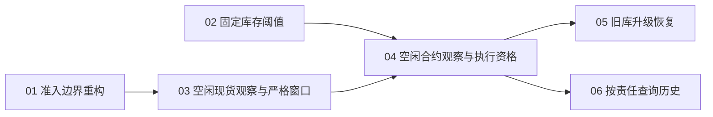

# 按实际库存补 BNB：阶段一本地 tickets

发布日期：2026-10-16（Asia/Taipei）。用户已确认六张票的粒度和依赖，并指定发布为本地 tickets。方案核查于 2026-10-15，基准分支为 codex/p1-implementation，基准提交为 dc8f3f3438d47f0ea75748e799ea8e35ca7faaf6。

六张正式 tickets 分别保存在 issues 目录。本地文件为正式跟踪来源；状态以各票 Status 为准，执行仍遵守 Blocked by 依赖。

当前进度（2026-10-16）：本地 `main` 已合并并推送至 `origin/main`，前次直接查询远端确认两者均为 `07b98c1`。已按用户授权清理全部 10 个完整合入 main 的本地 `codex/p1-*` 分支及先前对应的 worktree；最后 8 个分支没有关联 worktree。当前本地分支和登记的 worktree 均仅剩 main，本地 tickets、草稿、归档和验收日志完整保留。`p1-review-fixes` 的 5 个旧副本文档已核验并归档。合并后完整测试 **1,121 项通过（333.56s）**，包含仓库内 1,117 项及本地已有的 4 项诊断；六张票均为 `done`。推送与三轮清理证据见下方和 [review-fixes.md](./review-fixes.md)。

R5 时点记录（2026-10-16）：`07b98c1` 修复旧网格层位 P2，正常分层保留原规则，单笔最小回退检查全部未占价格；新增 23 项回归，定向 79 项及实现工作树完整 1,117 项通过（358.74s）。该记录保留为合并前验证历史。

R4 时点记录（2026-10-16）：01–06、首轮三项修复及首次复审 P2 完成时，提交为 `0020559`：实际挂单价格仍可负担最小合规买单时继续旧续作，新增 25 项回归，该时点完整测试 **1,094 项通过（356.64s）**。逐项记录见 [review-fixes.md](./review-fixes.md)，下方记录保留原始验证历史。

## 已确认的产品决定

1. 阶段一只在没有本机结算责任时接受外部余额变化；本机操作期间保留现有严格身份和结算核对。
2. 使用固定库存阈值，取消历史消耗速度/预计耗尽时间对紧迫度的影响；保留原有阈值、连续确认、退出缓冲和收尾规则。

## 必须明确的阶段一边界

仍可能成交的本机开放 GTC 也属于严格核对窗口，即使其当前提交结果已知、暂时没有新增成交。窗口必须在请求发送前存在，直到相关订单终态、成交完整和资产结算覆盖完成。窗口存在不等于所有动作都禁止；证据充分时继续按原规则分层下单和回划。

因此，开放本机订单期间，外部活动仍可能造成阻断。本轮只缩小严格审计适用时段，不声称完整支持共享账户并发活动，也不将时间戳或两次相同余额当作操作已覆盖的证明。

## 共同不变量

- 合约账户仍为 USDⓈ-M Futures；自动稳定币调出以配置资产的 maxWithdrawAmount 为权威基数。
- 保留最小划转单位硬 veto、单次比例、调出前后绝对下限和账户级滚动 24h 调出预算。人工/其他策略划转仍计入，UNKNOWN/PENDING 的原预占与去重保持，回扫不返还额度。
- 金额、价格、数量继续使用 Decimal；交易所访问留在 adapter/service 边界；沿用同账户串行控制和意图先落盘后发送。
- 不重发未知订单/划转，不用余额认领无可靠身份的划转，不以迁移或基线接受清除待结算状态。
- 保留账户 10 秒和行情/动态过滤器 5 秒有效期、执行前需求复核、风险变化检查、批次失效机制及保护性撤单。
- 当前相关外部 BNB 买单的敞口检查、冻结额与现货保留量保持；不扩大交易对、账户模式或保证金币种范围。
- 2026-10-16 审查修复阶段，用户明确改为：本机调资已确认结算、无未决且其他交易条件满足，当前资金不足最小合规买单时结束旧续作；不推断资金去向，下一有效库存周期仍遵守冷却、预算和全部划转风控。新 baseline 本身不触发补资。
- 每张行为变更票同步更新设计源文档及必要的术语/ADR。保留历史决策记录，新的决定只明确取代被改变的部分。
- 每票须有对应端到端离线证据；实施完成时对整组改动运行仓库完整回归。初次发布仅校验票据内容；后续实施的测试结果见各票及下方完成记录。

## 拆分与依赖

| Ticket | 交付 | Blocked by |
|---|---|---|
| [01](./issues/01-separate-execution-qualification.md) | 分离执行准入原因，保持当前行为 | 无 |
| [02](./issues/02-fixed-inventory-thresholds.md) | 仅按固定库存阈值决定补货紧迫度 | 无 |
| [03](./issues/03-idle-spot-balances-and-strict-window.md) | 空闲期接受外部现货余额，操作期间固定严格核对窗口 | 01 |
| [04](./issues/04-idle-futures-observation-without-global-audit.md) | 空闲期解除完整收入审计门槛，保留本机结算证明 | 02、03 |
| [05](./issues/05-safe-legacy-upgrade-and-recovery.md) | 旧数据库安全进入新观察模型并恢复未完成操作 | 04 |
| [06](./issues/06-bounded-evidence-queries.md) | 按结算责任查询历史，消除无关的长窗口扫描 | 04 |

01 是必要的保持行为前置重构；02 是与其独立的策略纵向切片。03 先交付现货外部变化的接受路径并建立严格窗口，04 再解除空闲阶段合约完整收入审计的门槛。05 和 06 在 04 之后可独立推进。



## 发布记录与领取规则

- 2026-10-16：用户批准拆分和依赖，指定本地发布；六张票统一设为 ready-for-agent。
- 01、02 无阻塞，可先领取；03 等待 01；04 等待 02、03；05、06 等待 04，之后可以并行推进。
- 每张票的验收条件和范围保持已批准草稿内容；完成前不得仅凭 ready-for-agent 状态忽略其阻塞关系。
- drafts 目录保留历史评审快照；后续状态和内容更新以 issues 中的正式票据为准。

## 实施完成记录

| Ticket | 状态 | 实现提交 | 对应验证 |
|---|---|---|---|
| 01 | done | `9b64a48` | 129 项准入、执行边界、收入审计与 CLI 恢复测试 |
| 02 | done | `27d081c` | 185 项固定阈值、状态机、策略与库存测试 |
| 03 | done | `ddafbf9` | 202 项库存接受、严格窗口、划转与重启测试；首轮两项断言修正后定向通过 |
| 04 | done | `58642a9` | 571 项观察/执行、预算、SDK 与收入证据测试；首轮两项夹具修正后定向通过 |
| 05 | done | `ec5f2bc` | 127 项旧库升级、故障注入、CLI 只读状态与续作测试 |
| 06 | done | `b2f3674` | 历史查询与恢复 76 项、全量 1,056 项、最后增量定向 40 项通过 |

全量命令（在实现工作树执行）：

```bash
PYTHONDONTWRITEBYTECODE=1 /home/suncong/bnb_treasury_bot/.venv/bin/python -m pytest -q -p no:cacheprovider
```

全量运行期间补充了旧划转基线缺少时间戳时的保守阻断及诊断；完整运行结果对应这次补充之前的 1,056 个用例，最终补充使用 `tests/integration/test_inventory_upgrade.py tests/integration/test_evidence_queries.py` 定向运行，40 项全部通过。没有连接实盘或发送真实订单/划转。

## 审查修复完成记录

| 修复 | 状态 | 提交 | 验证 |
|---|---|---|---|
| P1：跨交易对 ID 碰撞不能绕过接受边界 | done | `a9f550d` | 复现、库存接受及旧库恢复 44 项通过 |
| 退休订单迟到成交后恢复同一操作 | done | `e4009dd` | 复现、重启、未知操作和执行边界 144 项通过 |
| 已结算续作按当前资金不足退出 | done | `26e56e9` | 有/无来源回执、下一周期屏障、冷却与全部划转风控回归；最终全量 1,069 项通过 |
| 实际挂单价格仍可负担最小订单时继续旧续作 | done | `0020559` | 新增 25 项回归，定向 56 项及完整 1,094 项通过 |
| 旧网格订单不遮蔽可负担的未占低价层 | done | `07b98c1` | 新增 23 项回归，定向 79 项及完整 1,117 项通过 |

最终全量结果包含首轮最后补充的缺时间戳防护及本轮新增的 12 项复现回归；测试期间没有修改被测代码或测试。用户的新续作决定已写入 DESIGN 和 ADR 0005，正式票据相应验收条件已更新，旧草稿与原实施记录保留为历史。

上述 1,069 项是 R1–R3 完成时点的完整结果。R4 再增加 25 项实际挂单价及含费边界回归后，最终版本 `0020559` 的完整结果为 1,094 项通过（356.64s），同样在测试期间冻结被测代码和测试；相关设计及正式票据验收条件已同步。

R5 再增加 23 项旧网格占位及最低买单回归，最新版本 `07b98c1` 的完整结果为 1,117 项通过（358.74s）。运行期间冻结被测代码与测试，结束后差异一致性检查及 `git diff --check` 均通过；设计与正式票据已同步。

## 本地 main 合并验收（2026-10-16）

用户授权将 `codex/p1-implementation` 的 `07b98c1` 合并到本地 `main`。合并前 main 为 `80dbda4bed2c5a76fd042b9bc89f96aec8055e44`；执行 `git merge --ff-only 07b98c19fb7d4b1f72475b4b8f2bb09b81198c9e` 后，main 与实现分支均指向该提交，保留完整历史，不新增合并提交。

在 `/home/suncong/bnb_treasury_bot` 的 main 工作区执行：

```bash
PYTHONDONTWRITEBYTECODE=1 .venv/bin/python -m pytest -q -p no:cacheprovider
```

结果：**1,121 passed in 333.56s (0:05:33)**。收集核对确认包含 `tests/` 内 1,117 项及已有 `var/churn-diagnosis/test_churn_probe.py` 的 4 项本地诊断；后者未修改。完整输出保存在 [validation/main-07b98c1-pytest.txt](./validation/main-07b98c1-pytest.txt)。

测试期间未修改生产代码或测试；结束后确认 main 仍为 `07b98c1`，工作区和索引无已跟踪文件差异，两分支文件树相同（`151fe1e729cc3fb450e8e9530592dcfd3d2d4d55`）。原有 `.scratch` 本地票据保留，并同步六票验收记录；01–06 均为 `done`。该合并验收时尚未推送，后续推送及清理记录如下。

## 推送及本地清理（2026-10-16）

按用户授权执行 `git push origin refs/heads/main:refs/heads/main`，推送成功：`80dbda4..07b98c1 main -> main`。远端为 `https://github.com/Suncol/bnb_treasury_bot.git`；推送后及清理前分别通过 `git ls-remote --exit-code origin refs/heads/main` 查询，均返回 `07b98c19fb7d4b1f72475b4b8f2bb09b81198c9e`。本地 main 保持同一提交。

确认 `codex/p1-implementation` 已完整合入 main，且对应 worktree 无已跟踪修改、未跟踪或忽略文件后，执行 `git worktree remove /home/suncong/.codex/worktrees/p1-implementation/bnb_treasury_bot` 和 `git branch -d codex/p1-implementation`。Git 已删除目标 worktree 和本地分支，未使用强制删除。

main 工作区 `/home/suncong/bnb_treasury_bot`、本目录全部本地 tickets、历史草稿及验收日志保留。首次清理时 `codex/p1-review-fixes` 不在范围内，后续检查与清理见下方记录。01–06 状态均为 `done`，逐票已同步推送和清理结果。此次仅进行 Git 清理与本地记录更新，沿用上方合并后的完整测试结果。

## 追加清理 p1-review-fixes（2026-10-16）

用户要求确认没有未提交或未合并内容后清理 `codex/p1-review-fixes`。检查结果：分支停留在 `80dbda4bed2c5a76fd042b9bc89f96aec8055e44`，`git log main..codex/p1-review-fixes` 为空，祖先检查通过；暂存区和已跟踪工作文件没有差异，没有忽略文件。

worktree 中有 5 个未跟踪文档：`GLOSSARY.md`、ADR 0001–0003 和原 P1 票据 `docs/tickets/2026-10-15-p1-review-80dbda4.md`。它们全部与已合入 main 的提交 `b8b6b4ebdd0520cc1f583d9830e8c479ef2f21a0` 中同路径文件逐字节一致，没有独有的未提交内容。清理前已原样复制至 `archives/p1-review-fixes-80dbda4/`，并再次核验内容；[归档清单](./archives/p1-review-fixes-80dbda4/manifest.json)记录每个文件的大小、SHA-256、Git blob 和匹配提交。

仅移除核验和归档后的 5 个旧副本，确认 worktree 状态干净，再使用 `git worktree remove /home/suncong/.codex/worktrees/p1-review-fixes/bnb_treasury_bot` 和 `git branch -d codex/p1-review-fixes` 完成清理，无强制删除。当前登记的 worktree 仅有 main 工作区；main 保持 `07b98c1`，本地六票、草稿、归档和测试日志保留，01–06 均为 `done`。生产代码未变，沿用既有完整测试验收结果。

## 清理剩余 p1 分支（2026-10-16）

剩余 8 个本地 `codex/p1-*` 分支逐一通过 main 祖先核验，未合并提交数全部为 0，均无关联 worktree，已使用普通 `git branch -d` 删除。没有未合并分支需要保留；main 的已跟踪工作文件和暂存区无改动。本地仅剩 main 分支及其 worktree，main 和本地 origin/main 仍为 `07b98c1`。

六票均为 `done`，保留其验收、推送及此前清理记录，并逐票同步此次结果。草稿、五份文档归档和完整测试日志均与清理前哈希一致。分支名单、清理前提交及详细证据见 [剩余分支清理记录](./review-fixes.md#清理剩余-p1-分支2026-10-16)和[核验清单](./validation/p1-local-branches-cleanup-2026-10-16.json)。本次没有修改代码或测试，不重复运行测试。
